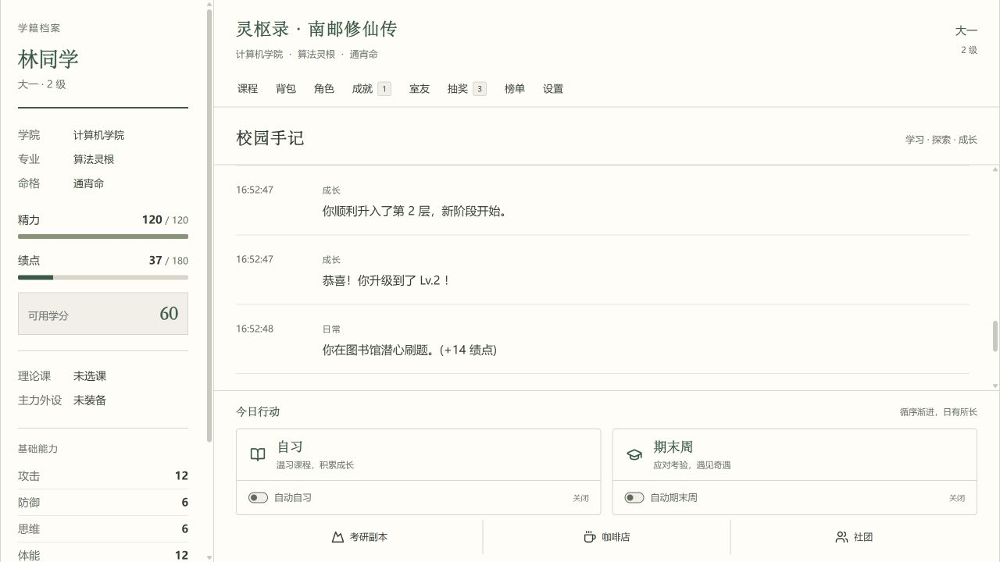

# 灵枢录 · 南邮修仙传

以南京邮电大学校园成长为主题的 React / TypeScript 文字游戏。当前界面采用纸本校园风：成长档案、入学登记和校园手记。



## 当前状态

已完成存档与弹窗的增量模块化、历史 ESLint 诊断清理和主要界面的纸本设计。源码检查、19项历史行为回归和生产构建通过。

**数值审计发现31项主要问题（7项优先处理），尚未修复。** 包括升级丢失部分加成、一键消耗和强化结算不一致、抽奖保底/奖励数量错误，以及室友战力未接入战斗。请先阅读[数值审计报告](doc/数值审计报告-2026-10-15.md)，不要将“回归通过”理解为数值系统已正确。

## 本地运行

需要 Node.js 22 与 npm。

```bash
npm ci
npm run dev
```

默认端口3000，已占用时由Vite选择下一个端口。游戏进度保存在当前浏览器，换浏览器或站点不会自动同步。AI默认关闭，使用本地模板。排行榜/UID后端与真实AI接口未做本轮集成验收。

## 检查与审计

```bash
npm test
npm run typecheck
npm run lint -- --max-warnings 0
npm run build
node scripts/numerical-audit/run.mjs . ./audit-output
```

审计脚本用固定时钟与随机数直接观测生产函数，不读取真实玩家存档，不请求网络。诊断输出包含已知缺陷，脚本完成不代表数值健康。

## 文档

- [模块边界](doc/MODULE_BOUNDARIES.md)
- [首轮维护工作报告](doc/工作报告-2026-10-15.md)
- [历史诊断修复报告](doc/历史问题修复报告-2026-10-15.md)
- [纸本校园界面报告](doc/纸本校园界面工作报告-2026-10-15.md)
- [数值审计报告](doc/数值审计报告-2026-10-15.md)
- [问题、作用矩阵与复现数据](doc/audit-data/2026-10-15)
- [发布说明](doc/PUBLICATION.md)

## 下载

[发布页](https://github.com/2822708/xiuxian-npu/releases/tag/v0.1.0-audit-20261015)提供源码包、无密钥网页构建包、审计数据包、脱敏Git快照及SHA256校验。网页包需要HTTP静态服务器；不代表已发布网站或验证真实后端。

## 发布范围

这是当前源码的脱敏快照。此前本机Git历史曾包含API密钥，因此没有把旧提交、旧构建或旧恢复bundle传到公开仓库。生产配置、玩家存档与排行榜数据均不在发布内容中。`VITE_*`会进入浏览器代码，不能承载服务端秘密。

历史策划和旧README保留在`PLAN.md`与[归档文档](doc/archive/README-original.md)，其中未实现的功能不代表当前行为。

本项目保留MIT许可证。上游工程参考：[react-xiuxian-game](https://github.com/Yvan0329/react-xiuxian-game)。
