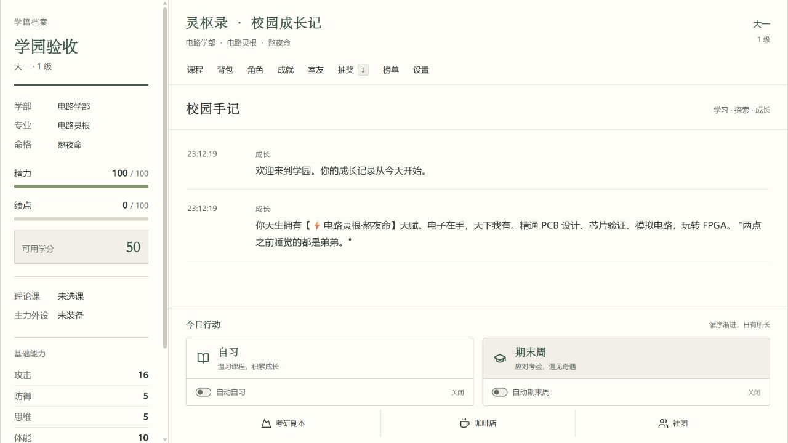

# 灵枢录 · 工科校园修仙传

**[在线试玩《灵枢录》](https://2822708.github.io/lingshu-campus/)**

在虚构工科学园中选课悟道、实验炼器、与同门论道。八个学部对应不同研习方向，成长档案、入学登记和校园手记采用纸本校园风。



## 当前状态

进入游戏可选“校园修行”或“灵枢试炼”。试炼是同一学园中的独立肉鸽，机巧器修、电路阵修、符算修士各有两套初始术式牌组。50关依次经历基础课筑基、实验炼器、竞赛论道、课题攻关和结业渡劫，穿插助研机缘、工坊服务、研习室调息及五场章节考核。34张术式和18件法器标注课程或实验来源，精力、试炼学分、术式和进度随本局单独保存。见[主题回归方案](doc/工科校园修仙主题回归方案-2026-10-31.md)。

灵枢试炼每章使用一张自下而上的十层路线图。沿虚线选择下一层相连的节点，提前查看战斗、精英、机缘、工坊与调息的分布。各路在章末考核汇合。地图和已走路线随本局保存，战斗中也可打开路线查看。旧局完成当前章后接入分岔地图。

已完成存档与弹窗的增量模块化、历史 ESLint 诊断清理、主要界面的纸本设计和虚构校园设定。既有回归包括80种旧天赋组合和旧存档显示兼容检查。

从“考研副本”打开三个随机遭遇：低、中、高风险各一项，点击整卡直接开战，也可刷新选择。每场自动携带8张基础、2张随机战术、至多3张已学课程和3张当前装备牌，组成10–16张本场简历；开局优先展示课程与装备来源牌。旧手配简历继续保留，不需要入场前手工整理。角色属性、装备被动、精力和战果仍与主游戏相通，费用与战斗现场一起保存。旧未完成战斗及探索可继续。详见[三选一与角色联动报告](doc/三选一副本与角色卡牌联动-2026-10-30.md)。

每回合3专注、抽4张，未出手牌保留，结束回合超过10张时手动弃到10张。正式手牌为高:宽4:3的竖牌，单行重叠铺开，悬停或聚焦置顶。战场使用套色版画、双方站位、人物下置血条与贴近敌人的行动提示。见[战场布局记录](doc/战场布局调整-2026-10-30.md)。

卡牌副本现有六类对手节奏、六张战术牌，以及十件真实装备的自动特性；可尝试破绽进攻、防守反击、留盾转攻等配合。主背包和战斗内装备笔记可查看特性，简历笔记显示真实课程、装备与入场属性。内容机制与此前数值抽查见[内容扩充报告](doc/战斗内容与装备机制扩充-2026-10-29.md)。

普通冲刺、幸运事件、战斗奇遇、社团挑战及旧档中未完成的战斗继续使用原逐轮操作：稳攻、防守、破势、撤离或自动应对一轮。六个预置机缘保留不同选项与后续。两种战斗均先保存现场再显示，终局统一结算一次，期间冻结外部成长和回血。社团胜利只发任务奖励，一键交付只处理普通任务。原逐轮系统见[接入报告](doc/全场景战斗接入报告-2026-10-21.md)。

10 月 22 日补强操作反馈：每轮伤耗、减免与暴击紧邻操作按钮；结算保留最后一击、突出实际收益，并可展开全部回合；机缘显示所选路线及后续线索。音效仅在操作保存成功后触发，沿用原开关与音量。玩法与数值规则保持原样，见[操作反馈增强报告](doc/操作反馈增强报告-2026-10-22.md)。

接入基础的检查与浏览器试玩证据见[正式接入报告](doc/卡牌副本正式接入报告-2026-10-27.md)，最新内容检查见上文内容扩充报告。本地已实测大厅准备、探索、卡战、手动弃牌、单行悬停、胜利结算和刷新续接；真实手机、全部场景和多标签锁仍未完整验收。

AI 接入基础已有初步实现：三种协议、13类接入预设、三项游戏内文案技能、集中提示词及异常输出校验。AI只润色程序已经确定的结果，默认关闭。上述六机缘由本地规则与预置文本运行，没有新增模型内容技能；模型生成分支、长项目与持久人物记忆仍待实现，道具和室友战斗支援暂缓。AI基础检查结果与当时的构建限制见[初步实现报告](doc/ai/初步实现报告-2026-10-16.md)。真实AI接入尚未完成验收。

后续独立自测修复了重复点击结算、未完成响应误判、配置异常显示和旧天赋叙事误判。122项自动化与5项本机HTTP检查通过，具体证据及未验收边界见[自测与修复报告](doc/ai/自测与修复报告-2026-10-16.md)。

**数值审计发现31项主要问题（7项优先处理），尚未修复。** 包括升级丢失部分加成、一键消耗和强化结算不一致、抽奖保底/奖励数量错误，以及室友战力未接入战斗。请先阅读[数值审计报告](doc/数值审计报告-2026-10-15.md)，不要将“回归通过”理解为数值系统已正确。

## 本地运行

需要 Node.js 22 与 npm。

```bash
npm ci
npm run dev
```

默认端口3000，已占用时由Vite选择下一个端口。游戏进度保存在当前浏览器，换浏览器或站点不会自动同步。互动机缘需要支持 Web Locks 的现代浏览器，在 localhost 或 HTTPS 页面使用；同一存档只允许一个游戏标签页写入。旧存档仍可导入，但旧客户端可能丢失互动扩展，不能保证降级后继续现场。AI默认关闭，使用本地模板。排行榜/UID后端与真实AI接口未做本轮集成验收。

## 独立卡牌试作

“课后演练”保留为三场独立试玩，运行 `npm run dev:cards`，访问 <http://127.0.0.1:3046/>。正式副本与其共享卡牌模板、纯结算内核及展示组件；试玩角色、配置和战果仍只保存在独立存档，不迁入主游戏。操作见[模块说明](prototypes/card-trial/README.md)，历史实现见[报告](doc/卡牌简历与保留手牌实现报告-2026-10-26.md)。

## 检查与审计

```bash
npm test
npm run test:ai:http
npm run typecheck
npm run lint -- --max-warnings 0
npm run build
node scripts/numerical-audit/run.mjs . ./audit-output
```

审计脚本用固定时钟与随机数直接观测生产函数，不读取真实玩家存档，不请求网络。诊断输出包含已知缺陷，脚本完成不代表数值健康。

## 文档

- [模块边界](doc/MODULE_BOUNDARIES.md)
- [首轮维护工作报告](doc/工作报告-2026-10-15.md)
- [历史诊断修复报告](doc/历史问题修复报告-2026-10-15.md)
- [纸本校园界面报告](doc/纸本校园界面工作报告-2026-10-15.md)
- [虚构校园改造报告](doc/虚构校园改造报告-2026-10-16.md)
- [数值审计报告](doc/数值审计报告-2026-10-15.md)
- [AI 增强实施方案（内容规划）](doc/AI增强实施方案-2026-10-16.md)
- [AI 体验与内容设计](doc/ai/体验与内容设计.md)、[技术草案](doc/ai/技术实施草案.md)、[验收计划](doc/ai/验收与评测计划.md)
- [接口与技能接入规划](doc/ai/接口与技能接入规划.md)、[初步实现报告](doc/ai/初步实现报告-2026-10-16.md)、[AI 接入说明](config/README.md)
- [AI 自测与修复报告](doc/ai/自测与修复报告-2026-10-16.md)
- [战斗参与与机缘分支规划（原提案）](doc/战斗参与与机缘分支规划-2026-10-18.md)
- [战斗与机缘实现报告（首版流程与简化边界）](doc/战斗与机缘实现报告-2026-10-20.md)
- [全场景战斗接入报告](doc/全场景战斗接入报告-2026-10-21.md)
- [操作反馈增强报告](doc/操作反馈增强报告-2026-10-22.md)
- [问题、作用矩阵与复现数据](doc/audit-data/2026-10-15)
- [发布说明](doc/PUBLICATION.md)

## 下载

[发布页](https://github.com/2822708/lingshu-campus/releases/tag/v0.1.0-audit-20261015)提供源码包、无密钥网页构建包、审计数据包、脱敏Git快照及SHA256校验。网页包需要HTTP静态服务器；不代表已发布网站或验证真实后端。

## 发布范围

这是当前源码的脱敏快照。此前本机Git历史曾包含API密钥，因此没有把旧提交、旧构建或旧恢复bundle传到公开仓库。生产配置、玩家存档与排行榜数据均不在发布内容中。`VITE_*`会进入浏览器代码，不能承载服务端秘密。

历史策划和旧README保留在`PLAN.md`与[归档文档](doc/archive/README-original.md)，其中未实现的功能不代表当前行为。

本项目保留MIT许可证。上游工程参考：[react-xiuxian-game](https://github.com/Yvan0329/react-xiuxian-game)。
