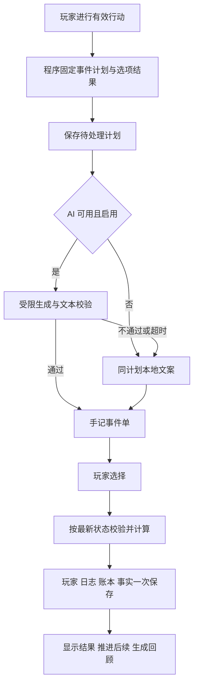

# AI 增强实施方案

日期：2026 年 10 月 16 日。状态：内容规划基线，分阶段实施。规划阶段交付方案、技术草案、内容示例和验收计划；方案依据实际代码，不把历史策划视为已实现功能。同日后续已完成部分接入基础，具体范围见[初步实现报告](ai/初步实现报告-2026-10-16.md)；本文的剧情、记忆、事务与公共服务目标不能据此视作已完成。

## 1. 推荐方向

把 AI 从“一次性随机文案生成器”升级为“有选择、有后续、能回顾的校园叙事层”。玩家每次行动既得到明确结算，也留下可被后续引用的经历。保持现有纸本校园界面，以手记中的事件单和成长档案承载内容，不再增加一套大型聊天界面。

实施顺序为：**可靠的生成边界 → 一条完整项目线 → 小规模事件库 → 事实记忆与成长回顾 → 公共服务能力**。先完成能从头玩到尾的一条线，再扩充数量。

| 玩家现在的感受 | 拟改善的体验 | 实现手段 |
| --- | --- | --- |
| 点击后获得一段随机文字 | 看到两至三个各有代价的选择 | 本地预置选项、费用和结果，AI 描写场景 |
| 上一次事件很快被遗忘 | 后续记得先前的决定 | 按已结算事实推进项目阶段 |
| 学部、命格与故事联系弱 | 同一事件有符合角色的观察角度 | 八学部、十命格标签进入上下文，不新增属性加成 |
| 室友主要呈现在属性栏 | 合作有连续经过和不同收尾 | 绑定已有室友的一条三阶段项目线 |
| 成长主要是数值增加 | 档案能说清做过什么 | 可核对的阶段回顾，附事实条目 |

## 2. 规划开始时的依据与优先问题

当前确有三类 AI 调用：`services/aiService.ts` 的事件生成、升学成功短句、对手命名。非战斗事件由 `views/adventure/useAdventureHandlers.ts` 接入；`executeAdventureCore.ts` 还有延后的额外副本事件调用。升学失败、战斗计算与结算主要仍由本地完成，尚无分支剧情、人物长期记忆或成长回顾系统。

事件上下文主要包含姓名、学阶与基础属性，副本另有地点信息；没有连续历史，也没有把学部、命格、室友经历形成事实投影。当前提示词的戏剧化表达倾向与克制的校园手记存在风格冲突，这是基于提示词的判断，尚未进行真实模型盲评。

更急迫的是可靠性：隔离 Mock 已复现缺少字段后结算出现 `NaN`、极大数值奖励进入状态；事件 JSON 缺少完整运行时校验，请求没有应用超时。连接测试成功也不能证明真实事件协议可用。AI 默认关闭、本地模板可运行，是后续渐进改造的基础。

历史[数值审计](数值审计报告-2026-10-15.md)仍有 31 项主要问题，其中 7 项优先处理。AI 加上边界不代表这些问题被修复。与新事件费用、收益或室友效果相关的缺陷，必须在对应模块启用前逐项复核并修复，或明确排除该效果；不能把已知错误用作新内容的预算依据。

## 3. 职责边界与完整闭环

**程序负责事实和规则，AI 负责表达。** 程序选择事件、生成唯一行动标识、固定随机结果、计算选项费用与收益、检查前置条件和推进阶段。AI 只能填写标题、正文、对白和选项标签，不能创造奖励、道具、人物关系或任务完成状态。费用和实际结果由程序插入界面，不依赖文本中的承诺。

一次行动只有一次结算。新剧情替换既有非战斗行动的本次结算，不能先执行普通奖励、再追加剧情奖励。现有奇遇叠加等合法组成部分，应在计划建立时合并进一次预算；战斗后的 AI 文字只能描述既有结果。失败、重试、刷新与关闭 AI 均使用同一计划，不能重新抽取。

保留现有本地规则、业务 ID、物品名称键和数值基线。停止采用模型自由生成奖励是拟议的明确行为变化，不能声称它与历史上每次任意模型奖励都相同。新选择的效果需单独校准；本文件的示例数字不直接作为生产配置。

## 4. 首版范围与玩家流程

首版硬上限：**6 个日常选择事件，每个 2—3 个选项；1 条三阶段室友项目；8 学部与 10 命格的叙事标签；1 种阶段回顾。** 学部和命格共享事件骨架，不制作 80 条组合剧情。先实现“研习室的传感器小项目”这一条线，验证成功后补齐六个日常事件。

项目以已有室友为参与者；没有室友时提供同学引导，不能偷偷创建带数值效果的室友。阶段按有效行动与项目状态推进，不设置真实时间周历或阅读倒计时。资源不足可收起事件单，补充资源后继续；只有角色、项目阶段或关键前置条件改变时才使旧计划失效。

事件单复用纸本手记，手机使用底部面板。正文简短，费用清楚，提供“稍后继续”。自动自习或自动期末遇到选择必须暂停，不能代选；关闭面板仍保持暂停，完成后由玩家恢复。AI 等待时可立即使用本地版本继续，不把网络等待做成游戏惩罚。

回顾先展示“做过什么、选择造成什么差异”，再提供一段可选润色。每项事实可追溯到已结算记录。它不授予奖励、不修改关系，也不虚构获奖、考试排名或未发生的合作。

完整三阶段样例、费用权衡与净变化见[体验与内容设计](ai/体验与内容设计.md)。本轮不扩展自由聊天、自动规划代理、向量数据库、多人 AI 编排或在线专属奖励。

## 5. 模块落点

沿用 React Hooks 与当前 handlers，不引入状态库，不接回尚未启用的旧 features Hook。

| 当前入口 | 拟调整或新增 | 交付责任 |
| --- | --- | --- |
| `services/aiService.ts` | `services/ai/requestCoordinator.ts`、`narrativeRenderer.ts` | 三类请求统一超时、取消、协议校验和同计划回退 |
| `views/adventure/useAdventureHandlers.ts`、`executeAdventureCore.ts` | `features/narrative/eventPlanner.ts`、`eventMachine.ts` | 固定规则结果，接入单次提交，清理延后请求竞态 |
| `views/breakthrough/useBreakthroughHandlers.ts`、`services/battleService.ts` | 受限短文本适配器 | 已确定结果再生成短句或名称，失败不影响规则 |
| `hooks/useGameState.ts`、`features/save/*` | `saveRepository.ts` 与可选剧情扩展 | 全快照保存、写入失败处理、导入导出与旧档兼容 |
| `App.tsx`、`features/modal/*` | `useNarrativeEvents.ts`、`NarrativeEventPanel.tsx` | 自动模式暂停、生命周期取消与纸本事件单 |
| `npu-data.ts`、`config/campusTheme.ts` | `features/narrative/content/*`、`memory.ts` | 虚构背景、标签投影、事件配置与有界事实 |
| `components/AIConfigPanel.tsx`、`config/userAIConfig.ts` | 配置状态与分级连接测试 | 区分可连接、文本可用、事件可用及是否已保存 |

拟保持存档 version 2 和原 key，新增可选 `narrative` 扩展及独立 `schemaVersion`。这仍是待实施的协议提案，现有 `createGameSave` 会丢弃未知扩展，必须同步改造全部自动、手动、导入导出路径。玩家变化、结算账本、剧情阶段与事实记忆写在同一份存档中，落盘成功后才显示领取成功。

同版本旧客户端再次保存可能丢失扩展，因此不承诺跨旧客户端保持剧情连续和幂等；返回新版时不能补发历史奖励。多标签页拟采用单写者锁，缺少锁能力时停用剧情结算，不能仅靠 localStorage revision 比较宣称跨页安全。细节见[技术实施草案](ai/技术实施草案.md)与[拟议决策](adr/0004-ai-narrative-boundary.md)。

## 6. 实施清单、依赖与完成条件

按里程碑验收后推进；以下是任务拆分，不是已完成记录或未经验证的工期承诺。

| 编号 / 阶段 | 任务与落点 | 依赖 | 可验收交付 |
| --- | --- | --- | --- |
| AI-01 / P0 | 建立合法响应、缺字段、极值及本地收益夹具；`tests` | 无 | 稳定复现旧问题并明确应保持的本地数值基线 |
| AI-02 / P0 | 提取本地计划，三类输出改为受限文本 DTO；`services/ai`、`features/narrative` | AI-01 | 缺字段、越权字段、未知 ID 均不能进入结算；离线同计划同收益 |
| AI-03 / P0 | 请求协调、取消代次、延后副本请求清理 | AI-02 | 超时结束等待；导入、重生、配置变化后迟到响应无副作用 |
| AI-04 / P0 | 分级连接测试、请求结果诊断和配置说明 | AI-03 | 空 HTTP 200 不误报事件可用；无密钥进入日志或构建产物 |
| AI-05 / P1 | 全快照提交与存档扩展；`features/save`、`useGameState` | AI-02；相关数值审计处置 | 所有玩家写入口串行；异常落盘不虚报成功；旧档及导入导出通过 |
| AI-06 / P1 | 事件状态机、行动幂等、生命周期与单写者 | AI-03、AI-05 | 双击、刷新、双标签、旧响应不能重复扣费发奖 |
| AI-07 / P1 | 手记事件单和自动模式暂停；`App`、组件 | AI-06 | 手机费用清晰，能稍后继续，无后台代选 |
| AI-08 / P1 | 一条三阶段项目的完整纵向试作 | AI-07 | 有/无室友、两类路线、在线/离线均可核对完成；不重复普通收益 |
| AI-09 / P1 | 补齐 6 个事件、8/10 标签与模板回顾 | AI-08 | 所有选项存在实际取舍，回顾逐项有据，不扩张首版范围 |
| AI-10 / P2 | 跨事件事实记忆与 AI 阶段回顾 | P1 全部通过 | 关系不串角色，遗忘和摘要不改规则，回顾前后状态完全相同 |
| AI-11 / P2 | 小样本盲评与内容调优 | AI-10；真实接口和浏览器可用 | 留存 30 条样本、独立评分、用量和延迟报告；无严重事实错误 |
| AI-12 / P3 | 可选公共代理、鉴权、配额与服务运维 | P2；明确公共部署需求 | 服务端保管共享凭证、额度可执行、故障自动回到本地路径 |

P0 是第一实施批次；P1 的验收目标是“玩家完整玩完一个有后续的选择故事”，而非“按钮能请求模型”。P2 在内容闭环稳定后增强连续性；P3 不能阻塞本地完整玩法。

## 7. 初始参数、配置与成本控制

以下均为拟定初值，实施与评测后调整，不是当前测量结果：

| 项目 | 初始方案 |
| --- | --- |
| 请求 | 并发 1，最多排队 2；总超时 12 秒；MVP 默认不自动重试，玩家重试不重抽计划 |
| 文案 | 正文建议 120—240 汉字，单次受控文本总上限 800 字符；规则字段超限直接拒绝 |
| 记忆 | 最近事件 24 条、事实最多 64 条、关系条目最多 16 个；重要阶段优先保留 |
| 请求频率 | 每事件最多一次生成；缓存按计划、事实版本及提示版本隔离，回顾由玩家主动请求 |
| 质量目标 | 30 条首轮样本最多 1 条格式失败、严重事实错误 0；所有拒绝路径状态安全率 100% |

账本的去重记录不能按上述记忆容量直接淘汰，须结合行动序号水位保证归档后不可重放。文本缓存不能跨玩家串用；提示只发送所需事实，去除 UID 和无关原始日志，人物以稳定 ID 区分。

本地阶段保留用户自配接口的可选方式，明确浏览器凭证会发送到所选服务方；不内置共享开发密钥，也不把 `VITE_*` 当服务端秘密。P3 如需面向普通玩家提供默认服务，再设计服务端凭证、额度与限流。真实评测只用受控测试角色与仓库外短期凭证，记录用量，不预设具体模型价格或采购结论。

功能开关分开控制“模型生成”和“新剧情创建”：关模型仍能完成同计划本地剧情；停用新剧情只阻止创建新计划，保留已有待选事件和账本。不能以退回会丢扩展的旧客户端作为正常回滚方案。

## 8. 验收与本轮交付

实施前保留现有检查：`npm test`、`npm run typecheck`、`npm run lint -- --max-warnings 0`、`npm run build`。另按[验收与评测计划](ai/验收与评测计划.md)新增协议、故障、浏览器和真实模型评测入口；这些入口目前尚不存在。

首版发布要求：P0 安全用例全部通过；P1 完整故事、旧档、存储异常、自动暂停及手机交互通过；在线与离线同一选择的规则结果一致。真实模型质量与成本报告单列，Mock、编译成功与类型检查都不能代替真实业务集成。

当前会话尚未完成持续可访问的浏览器服务与真实 AI 接口验收。恢复测试环境是浏览器验收的前置工作，不能据此判断剧情已经能用。规划阶段只检查文档结构、引用与范围一致性；后续代码检查结果另见实现报告，未声称修复旧数值缺陷或上线完整剧情能力。

规划交付为本总方案、三份专项设计、ADR 0004，以及 README 和维护上下文入口。同日后续已对 AI-01 至 AI-04 做接入基础的初步实现，剩余验收和边界见[实现报告](ai/初步实现报告-2026-10-16.md)。完成真实集成验证后，再推进 AI-05 至 AI-08 所需的保存和完整故事链。
