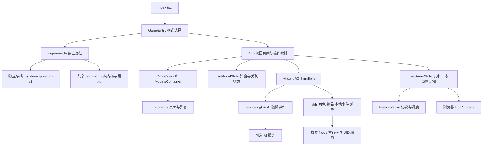

# 灵枢录现行架构与功能模块说明

本说明于 2026 年 10 月 15 日形成，10 月 22 日按全场景战斗接入和操作反馈更新。保留 React Hooks 和 handlers 体系，不实施历史策划中的 Zustand、目录搬迁、九境界或 3v3 方案。

## 运行结构

`constants.ts`、`npu-data.ts` 提供玩法数据，`types.ts` 定义共享协议。实际学阶为大一、大二、大三、大四、硕士、博士、院士。AI 默认关闭，以本地事件运行；开启后的 AI 请求与排行榜请求属于不同的网络边界。

2026-10-31增加独立肉鸽模块。`GameEntry`只挂载所选模式，远征不导入主角色、成长Hook、校园存档或经济服务。`features/rogue-mode/catalog.ts`维护职业、初始牌组、原创卡面、遗物和节点；`engine.ts`负责50节点状态机与奖励；`persistence.ts`负责限长校验、旧快照比较和损坏档备份；`RogueMode.tsx`先保存再展示。共享卡战仅承接冻结的生命、牌组、遗物效果和敌方行动循环。详见[隔离决策](adr/0007-independent-rogue-mode.md)。

## 职责与依赖方向

| 模块                                                                           | 责任                                                                                 | 边界约束                                                        |
| ------------------------------------------------------------------------------ | ------------------------------------------------------------------------------------ | --------------------------------------------------------------- |
| `App.tsx`                                                                      | 组合屏幕、handlers、自动操作、死亡状态和效果                                         | 继续承担编排，纯存档迁移已移出                                  |
| `hooks/useGameState.ts`                                                        | 玩家、日志、设置和开始、继续、删除操作                                               | React、localStorage、UID 请求与提示保留在此                     |
| `features/save/saveCodec.ts`                                                   | 版本判断、导入检查、字段补齐、背包修复、信封创建                                     | 无 React 状态、localStorage 访问、网络或提示弹窗                |
| `features/save/autoSaveScheduler.ts`                                           | 最新快照、2 秒尾沿保存、10 秒等待上限、取消                                          | 不知道玩家结构与存储位置；时钟可注入                            |
| `features/interactive/battle.ts`                                               | 同一战斗内核、固定随机数、逐轮指令、四类终局                                         | 不写存档、不发奖励、不调用模型                                  |
| `features/interactive/adventureBattle.ts` 与 `state.ts`                        | 场景奖池、费用、社团次数、父行动和一次结算                                           | 纯规则计算，由 useGameState 先保存后展示                        |
| `components/InteractiveEncounterModal.tsx` 与 `InteractiveBattleFeedback.tsx`  | 机缘选择、已保存的最新轮、伤耗与减免、最后一击、结算及回合记录                       | 只读展示已有结果，不重算战斗或发奖；音效由 App 在保存成功后触发 |
| `features/modal/useModalState.ts`                                              | 普通弹窗、移动端面板、商店、强化、通知                                               | 不接管战斗、死亡、冷却和自动操作                                |
| `views/*/useXxxHandlers.ts`                                                    | 自习、升学、物品、装备、课程、配方、角色、商店、副本、室友、抽奖、社团、成就、期末周 | 通过回调更新玩家和日志，由 App 组合                             |
| `views/GameView.tsx` 与 `views/modals/ModalsContainer.tsx`                     | 页面和按需加载弹窗的组合                                                             | 组件通过 props 获取状态与操作                                   |
| `index.css`、`styles/entry.css`、`styles/navigation.css`、`styles/journal.css` | 纸本校园主题变量、入口、导航、档案和手记样式                                         | 仅影响展示，业务仍由 handlers 与服务处理；见 ADR 0002           |
| `services/` 与 `utils/`                                                        | 战斗、文本、物品推断、角色初始化、音效与网络客户端                                   | 本轮保留现有依赖，混合职责尚未全部拆分                          |
| `server/leaderboard-server.mjs`                                                | 排行榜和 UID API，以 JSON 文件持久化                                                 | 与浏览器存档独立，游戏可运行不代表接口集成已验证                |

## 关键流程

创建角色：`StartScreen → handleStartGame → ensureUid → createInitialPlayer → 立即保存 → 游戏屏幕`。

继续游戏：检查版本、补齐 UID，调用 `restoreSavedPlayer` 修复背包和同版本缺省字段，最后设置玩家与日志。键仍为 `npu-game-save` 和 `npu-game-settings`，版本仍为 2。数字日任务次数转四类计数、回血倍率使用 `?? 1`、默认日期使用 UTC 日期字符串等规则均维持原实现。

导入：`SettingsModal → parseImportSave → 用户确认 → 写入 → 刷新`。旧版本、损坏 JSON、非对象玩家和非数组日志在覆盖前被拒绝。它不是完整的 PlayerStats 运行时 schema，不能保证任意缺字段或恶意存档均可加载。

自动保存：每次更新替换待保存快照；停止操作 2 秒后保存，连续更新则在前台正常计时条件下每周期最多等待 10 秒。关闭自动保存、离开游戏或卸载会取消待保存任务，不额外强制保存。后台节流和异常退出保障未在本轮验证。

战斗：`冒险 / 副本 / 社团挑战 → App.startBattle → begin-battle → 固定现场并保存 → InteractiveEncounterModal → 每轮指令 → 父行动一次结算`。三选项机缘可从 choose 进入同一内核。`services/battleService` 的同步敌人/掉落工具继续复用，旧完整自动 resolver 只用于兼容回归。

非战斗事件继续 `useAdventureHandlers → executeAdventureCore → setPlayer`；其中触发的随机副本会通过回调返回统一入口。自习仍为 `App → useMeditationHandlers → 更新绩点与回血增益`。当前验证及存档边界见[全场景战斗接入报告](全场景战斗接入报告-2026-10-21.md)。

## 旧模块和文档

旧 `features/meditation` 缺少现版学阶收益、顿悟和回血增益；旧 `features/game` 使用不同的冷却递减方式；旧 `features/battle` 自带回合定时器；旧 `features/shop` 打开流程和旧 `features/items` 批量处理也不完整。因此它们继续保留为未接入的历史代码。

`doc/ARCHITECTURE.md`、`doc/MODULES.md` 与 `PLAN.md` 的部分内容属于旧架构或计划。README 所称 TypeScript 严格模式尚未落实到 tsconfig 的 `strict` 选项。本说明优先描述实际源码。

历史诊断后续清理已完成，见同目录的历史问题修复报告。`hooks/useLatestRef.ts` 为长生命周期回调提供提交后的最新值，自动操作与升学检查仍按原状态字段触发。设置持久化现已与玩家自动存档解耦：关闭自动保存后，音效等设置仍单独保存。

## 正式卡牌副本（2026-10-27）

大厅主动入场使用 `App → begin-dungeon → features/card-dungeon → features/card-battle → 父行动结算`，替换该入口的逐轮战斗。`sources/loadout` 只处理真实课程、实际装备和简历配置；`numericAdapter` 将原战斗计划适配为冻结牌面；卡战引擎只处理纯指令、牌区和战斗精力，不读存储、不发物品、不调用模型。共享 `shared.ts`、模板和展示组件也供独立试作使用，三场试作的角色与奖励状态不进入主游戏。

2026-10-30的新入口模式为 `entryMode: 'rogue'`：`offers.ts` 生成三个同学阶、不同风险的报价；`rogueLoadout.ts` 从真实可用来源确定性抽取本场简历，并通过牌区交换展示开局来源牌。`SecretRealmModal`只展示三个选择和刷新；旧准备模块不再处于主入口链路。自动简历存在 `pending.dungeon.entryLoadout`，不覆盖全局旧手配；断点恢复按该冻结简历校验，旧现场没有此字段时回退原规则。主入口直接开战，已有的非战斗探索现场仍可读取及完成。详见[决策记录](adr/0006-rogue-dungeon-entry.md)。

`features/interactive/state.ts` 仍负责入场扣费、命令序号、一次终局与延毕；`useGameState` 取得页面写入权，先保存完整快照再发布界面。新大厅非战斗探索复用 `utils/adventureResult.ts` 的原资源规则，费用与探索结果一次落盘。旧 `executeAdventureCore` 也使用此共享更新函数，其他入口行为不变。互动协议2增加简历及卡战现场，旧协议1现场读入后继续旧引擎；外层存档版本和业务ID不变。详见[正式接入报告](卡牌副本正式接入报告-2026-10-27.md)。

## 后续整理顺序

2026-10-29卡战内容扩充：`features/card-battle/enemies.ts`定义敌人行动循环，入场时复制进战斗快照；`engine.ts`负责机制与精确来袭预览。`card-dungeon/equipment.ts`统一现有装备与特性的匹配，`budgets.ts`供牌面和装备共用最终角色预算，`numericAdapter.ts`继续保留旧导出路径。背包与装备栏仅读取特性说明，副本特性不参与旧逐轮战斗。新增战术不进入独立试作奖励池。详见[内容扩充报告](战斗内容与装备机制扩充-2026-10-29.md)。

先修复检查中的真实缺陷，再处理装备效果转换与商店售价的单一来源、稳定日志回调、统一排行榜和 UID 客户端配置。之后再评估清理旧 Hook 与拆分 `constants.ts`。每次提取都应核对输入输出、默认值及随机调用顺序，避免为目录整齐替换实际业务实现。
