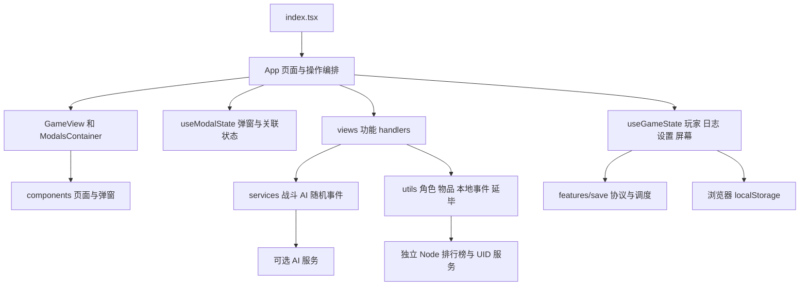

# 南邮修仙传现行架构与功能模块说明

本说明基于 2026 年 10 月 15 日的实际源码，记录已落地的模块边界。本轮保留 React Hooks 和 handlers 体系，不实施历史策划中的 Zustand、目录搬迁、九境界或 3v3 方案。

## 运行结构

`constants.ts`、`npu-data.ts` 提供玩法数据，`types.ts` 定义共享协议。实际学阶为大一、大二、大三、大四、硕士、博士、院士。AI 默认关闭，以本地事件运行；开启后的 AI 请求与排行榜请求属于不同的网络边界。

## 职责与依赖方向

| 模块 | 责任 | 边界约束 |
| --- | --- | --- |
| `App.tsx` | 组合屏幕、handlers、自动操作、死亡状态和效果 | 继续承担编排，纯存档迁移已移出 |
| `hooks/useGameState.ts` | 玩家、日志、设置和开始、继续、删除操作 | React、localStorage、UID 请求与提示保留在此 |
| `features/save/saveCodec.ts` | 版本判断、导入检查、字段补齐、背包修复、信封创建 | 无 React 状态、localStorage 访问、网络或提示弹窗 |
| `features/save/autoSaveScheduler.ts` | 最新快照、2 秒尾沿保存、10 秒等待上限、取消 | 不知道玩家结构与存储位置；时钟可注入 |
| `features/modal/useModalState.ts` | 普通弹窗、移动端面板、商店、强化、通知 | 不接管战斗、死亡、冷却和自动操作 |
| `views/*/useXxxHandlers.ts` | 自习、升学、物品、装备、课程、配方、角色、商店、副本、室友、抽奖、社团、成就、期末周 | 通过回调更新玩家和日志，由 App 组合 |
| `views/GameView.tsx` 与 `views/modals/ModalsContainer.tsx` | 页面和按需加载弹窗的组合 | 组件通过 props 获取状态与操作 |
| `index.css`、`styles/entry.css`、`styles/navigation.css`、`styles/journal.css` | 纸本校园主题变量、入口、导航、档案和手记样式 | 仅影响展示，业务仍由 handlers 与服务处理；见 ADR 0002 |
| `services/` 与 `utils/` | 战斗、文本、物品推断、角色初始化、音效与网络客户端 | 本轮保留现有依赖，混合职责尚未全部拆分 |
| `server/leaderboard-server.mjs` | 排行榜和 UID API，以 JSON 文件持久化 | 与浏览器存档独立，游戏可运行不代表接口集成已验证 |

## 关键流程

创建角色：`StartScreen → handleStartGame → ensureUid → createInitialPlayer → 立即保存 → 游戏屏幕`。

继续游戏：检查版本、补齐 UID，调用 `restoreSavedPlayer` 修复背包和同版本缺省字段，最后设置玩家与日志。键仍为 `npu-game-save` 和 `npu-game-settings`，版本仍为 2。数字日任务次数转四类计数、回血倍率使用 `?? 1`、默认日期使用 UTC 日期字符串等规则均维持原实现。

导入：`SettingsModal → parseImportSave → 用户确认 → 写入 → 刷新`。旧版本、损坏 JSON、非对象玩家和非数组日志在覆盖前被拒绝。它不是完整的 PlayerStats 运行时 schema，不能保证任意缺字段或恶意存档均可加载。

自动保存：每次更新替换待保存快照；停止操作 2 秒后保存，连续更新则在前台正常计时条件下每周期最多等待 10 秒。关闭自动保存、离开游戏或卸载会取消待保存任务，不额外强制保存。后台节流和异常退出保障未在本轮验证。

期末周：`ActionBar → App → useAdventureHandlers → 战斗或事件生成 → executeAdventureCore → setPlayer`。自习：`App → useMeditationHandlers → 更新绩点与回血增益`。主要业务入口保持不变。

## 旧模块和文档

旧 `features/meditation` 缺少现版学阶收益、顿悟和回血增益；旧 `features/game` 使用不同的冷却递减方式；旧 `features/battle` 自带回合定时器；旧 `features/shop` 打开流程和旧 `features/items` 批量处理也不完整。因此它们继续保留为未接入的历史代码。

`doc/ARCHITECTURE.md`、`doc/MODULES.md` 与 `PLAN.md` 的部分内容属于旧架构或计划。README 所称 TypeScript 严格模式尚未落实到 tsconfig 的 `strict` 选项。本说明优先描述实际源码。

历史诊断后续清理已完成，见同目录的历史问题修复报告。`hooks/useLatestRef.ts` 为长生命周期回调提供提交后的最新值，自动操作与升学检查仍按原状态字段触发。设置持久化现已与玩家自动存档解耦：关闭自动保存后，音效等设置仍单独保存。

## 后续整理顺序

先修复检查中的真实缺陷，再处理装备效果转换与商店售价的单一来源、稳定日志回调、统一排行榜和 UID 客户端配置。之后再评估清理旧 Hook 与拆分 `constants.ts`。每次提取都应核对输入输出、默认值及随机调用顺序，避免为目录整齐替换实际业务实现。
