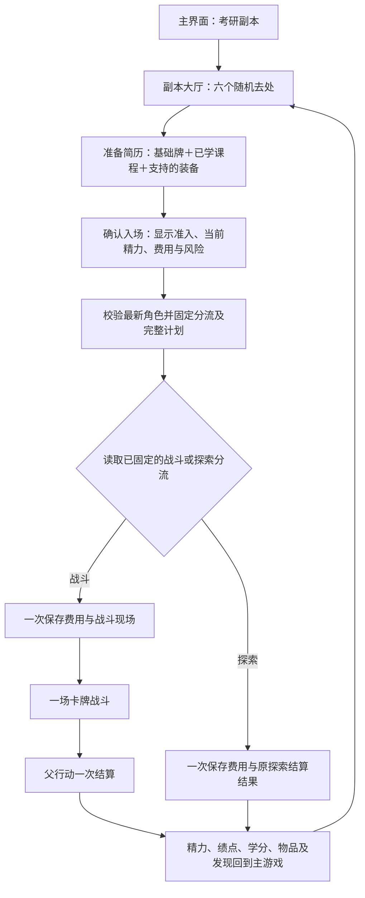

# 卡牌副本模块化接入方案

日期：2026-10-26　原状态：提议。用户随后授权实装，2026-10-27 已完成本地接入，当前状态见[正式接入报告](卡牌副本正式接入报告-2026-10-27.md)。以下保留当时设计依据与验收约束。

本轮依据当前源码设计合并方案，只新增本文档。卡牌仍是独立试玩；本方案不代表主游戏已接入、存档已迁移或数值已验收，也不包含提交、上传和上线。

## 1. 推荐结论

由新“卡牌副本”模块承接原“考研副本”入口，保留六个随机副本的选择、准入、费用、风险、掉落与非战斗探索；其中发生战斗时，改用一场卡牌战斗。角色直接使用主游戏当前属性，课程和部分已装备道具提供可加入简历的牌，战果回写原角色、背包和成长体系。

首版不把一次入场扩成三连战，不新增地图、遗物、职业树、货币或养成等级。独立试玩保留三场结构，作为后续比较和训练入口。新模块只接管从副本大厅主动进入的流程，其他战斗继续沿用现有逐轮系统。

这里“替代考研副本”指替换该入口背后的模块和战斗体验，不是删除其中原有的探索、课程发现和掉落内容。

## 2. 已核实的现状与合并约束

| 当前事实                                                                                      | 对合并的约束                                                 |
| --------------------------------------------------------------------------------------------- | ------------------------------------------------------------ |
| 大厅调用 `generateRandomRealms(player.realm, 6)`，不是直接展示 `SECRET_REALMS` 的三个静态定义 | 延用实际运行的随机副本目录，不能按旧常量重新造一套副本       |
| 副本有四档风险、准入学阶、随机费用和掉落提示，可主动免费刷新                                  | 新界面保留这些信息与刷新规则；准备简历不扣费                 |
| 入场要求达到准入学阶、精力不少于最大值的三成、学分足够，并受现有冷却及行动锁限制              | 最终入场时根据最新角色重新检查，不能只检查打开面板时的旧数据 |
| 副本会分流到战斗或非战斗探索，并非每次都战斗                                                  | 首版保留分流及原有非战斗内容；“每次必打”属于另一次玩法调整   |
| 当前副本战斗已有固定敌人、奖池、费用与发现结果的父行动计划                                    | 卡牌读取同一份计划，不另生成对手、费用或奖励                 |
| 主游戏战斗已有先保存后展示、父行动一次结算、刷新续接、单标签页写入保护                        | 复用这些能力，不把试玩的独立存档系统带进主游戏               |
| 当前非战斗副本是先保存费用，再走普通事件结算，尚非完整事务                                    | 新入口需要补齐该分支的固定结果与原子结算，不能宣称现状已具备 |
| 试玩使用满精力开局、约 34–90 的精力范围、三场固定强度梯度及场间恢复                           | 这些是试玩设定，正式接入不能直接照搬                         |

现有战斗触发概率为：

```text
P = clamp(0.05, 0.75,
    0.45 + 角色学阶序号 × 0.015 + 手速 × 0.0004 − 幸运 × 0.0002)
```

首版保留此公式。学分费用、掉落概率和发现概率沿用现有规则；改变战斗操作方式不构成额外发奖理由。

## 3. 玩家流程与体验



### 3.1 大厅与准备

- 主界面入口名称、位置先保留。大厅内部增加“我的简历”，默认八张基础牌即可进入，不要求先配课或收集装备。
- 选中副本后，准备区展示真实角色、简历张数、课程/装备来源及入场费用。最终确认之前可以自由修改简历和离开。
- 大厅持有当前批次的副本列表及批次标识，入场只提交副本 ID；由主流程查出真实费用、风险、学阶及掉落，避免界面传入过期或自行拼装的副本参数。
- 免费刷新使旧的未付款选择失效，简历草稿保留；界面普通重绘不重新随机。已付款现场不受大厅刷新影响。
- 正式界面移除示例角色、任意学阶/层级选择、JSON 档案导入、手填种子与免费重开按钮，自动读取当前主角色。

### 3.2 战斗

保留已经试过的简单操作：每回合 3 点专注、开始时及每回合尝试抽 4 张、未出手牌保留。回合结束若超过 10 张，玩家手动弃到 10 张后才执行敌人行动；可取消弃牌返回出牌。十张是结束回合的软上限，不是抽牌硬上限；抽牌后允许暂时超过十张，牌堆不足则按实际数量反馈。

一场只对应原来的一次战斗。建议正式副本保留原系统的 12 个完整决策回合上限，仍存活但未获胜时按僵持撤离；试玩继续使用 18 回合。出牌、点选弃牌及取消不增加回合；玩家提前击杀不追加敌袭。第十二轮仍先完成必要弃牌和敌袭，再按死亡优先于僵持的顺序判断，避免吞掉最后一击。

战斗期间仍冻结外部成长、自动行动、回血和装备修改。每次操作保存成功后，才播放出招、受击、防护、恢复和抽牌反馈；刷新不重播历史动画。当前意图和本张牌的实际效果均可预览。

### 3.3 结果回到养成

结果页展示“入场精力 → 战斗结束精力 → 发现/延毕后的最终精力”、实际费用、绩点/学分变动、掉落、课程与天赋发现。结算后新发现的课程可用于下一次简历；新装备也可在正常装备后成为后续牌源。确认结果只关闭现场，不再次领取奖励。

## 4. 牌库、简历与主游戏的关联

“牌库”表示玩家选择收录的可用牌，“简历”表示本次准备携带的牌组；两者都是配置，不是新增可买卖物品。首版沿用试玩的 8–16 张简历、至少一张进攻牌及基础牌实例数量限制，不新增卡牌合成、升级或重复刷牌奖励。正式默认仍只提供八张基础实例，扩展来自课程和装备；试玩过关三选一中的额外基础功能牌暂留试玩，不在正式版新增永久获取渠道。全目录仍统一适配数值，避免共享内核遗留固定常数。

| 来源       | 进入牌库的条件                                   | 加入简历的规则                                                      | 与角色成长的关系                                             |
| ---------- | ------------------------------------------------ | ------------------------------------------------------------------- | ------------------------------------------------------------ |
| 基础牌     | 默认提供现有八张基础实例                         | 同一实例只能选一次，可调整是否携带                                  | 基础攻击、防护也随真实角色成长，避免高学阶基础牌失效         |
| 已学课程   | 读取当前 `cultivationArts`，映射到六类课程牌模板 | 一个已学课程提供一个来源实例；不同课程可共用模板但保留各自名称与 ID | 学习课程仍按原规则增加角色属性，同时解锁出牌方式             |
| 支持的装备 | 拥有且实际装备的四类白名单道具                   | 一个真实装备实例最多提供一张来源牌，数量和重复槽位不复制牌          | 装备被动属性已经进入角色属性，不再次叠加强化、品质或本命倍率 |
| 其他装备   | 不额外造牌                                       | 暂不加入简历                                                        | 仍通过角色最终攻击、防御等影响基础战斗，原收益保留           |

建议正式版将试玩“拥有支持装备即可配牌”收窄为“实际装备后才可带入简历”，使出牌与角色当前装备一致，避免借用背包里多套装备的主动效果。

课程模板继续保留代码推演、清醒应对、抽象求解、算法连击、矩阵验算、稳态实验；装备模板先保留键盘速击、整装防护、隔绝干扰、护腕调整。正式适配优先使用已有稳定业务 ID；目前试玩装备按名称识别，不能把易改动的显示名继续当作唯一规则依据，也不应给历史物品重编 ID。

未把课程牌带入简历，不代表退课或移除其被动属性；选择装备牌也不再增加一次装备属性。卸下、卖出或失去来源后，下一次准备显示“来源已失效”，停止入场并提供明确的“补齐基础牌”操作；不偷偷替换后扣费。入场后使用冻结快照，不能通过临时换装或卖出来源改变正在进行的战斗。

不自动读取或合并试玩的两个独立存档键。主游戏首次接入使用基础简历；试玩配置若将来提供导入，只能导入偏好并重新验证来源，不能带入试玩角色、血量、战果或奖励。

## 5. 数值接入：保留成长，先校准再定系数

### 5.1 精力使用主游戏原值

- 入场精力等于最新 `player.hp`，最大值等于 `player.maxHp`，不满血重置，不压到试玩范围。
- 引擎统一以主游戏原始整数计算精力、伤害、防护和恢复。原始整数也是结算依据，不进行“主游戏精力 → 小数尺 → 主游戏精力”的往返换算。
- 首版界面优先直接展示原始值及千分位。若高阶需要简写，简写只用于展示，明细保留原值；不得因格式化出现“显示伤害与扣血不一致”。
- 战斗恢复只能恢复本场新受损耗，最高到入场精力；取消试玩的开局补满和场间 +6。未出牌立即撤离，精力必须原样返回，已付费用不退。
- 该恢复上限只约束战斗引擎的退出精力。父结算之后，原有课程/天赋发现增加最大精力并补精力、精力归零后的延毕恢复等仍按原规则执行，不能被再次截回入场值。

例：150 精力入场，受到 20 损耗后恢复 10，退出为 140；没有战斗损耗时打恢复牌不能把原有缺口补满。

### 5.2 对手直接复用原副本计划

使用 `createAdventureBattlePlan` 已冻结的 `plan.enemy`：学阶、攻击、防御、精力、手速和行为类型都来自原计划。当前敌人结构不含层级字段；层级由同次入场的角色快照固定为 `referenceLevel = clamp(floor(player.realmLevel), 1, 9)`，供生成和来源加成参照使用。不能再调用试玩三场弱/普通/强生成器，也不能第二次乘风险或强度系数。

当前实际副本数值基准来自准入学阶 `realmMinRealm`，层级比例 `s = 1 + 0.1 × (层级 − 1)`。其生成基底为：

```text
攻击 = 0.8 × 准入学阶基础攻击 × s
防御 = 0.8 × 准入学阶基础防御 × s
精力 = min(0.4 × 准入学阶基础精力, 4 × 准入学阶基础攻击) × s
手速 = 0.95 × 准入学阶基础手速 × s
```

随后原生成器会应用风险、弱/普通/强抽样、属性波动和高学阶挑战低学阶的压制修正。上式不是最终敌人数值；新模块只接收最终快照，避免重算漏项或重复加成。装备变强不会令对手同步上涨，升学和装备积累仍有实际优势。

### 5.3 角色各数值的用途

| 主游戏数值    | 正式副本用途                                                       | 边界                                                         |
| ------------- | ------------------------------------------------------------------ | ------------------------------------------------------------ |
| 当前/最大精力 | 真实入场状态、伤耗承受及退出回写                                   | 不另造第二条永久生命值                                       |
| 攻击          | 所有进攻牌的公共基础预算，算法类牌另有受限加成                     | 不只增强少量来源牌，也不重复加装备被动                       |
| 防御          | 参与原敌袭基础减伤，并影响主动防护牌预算                           | 被动减伤与花专注获得防护是两个明确作用，不能再重复扣一次防御 |
| 思维          | 抽象求解等课程牌的属性加成                                         | 不额外永久增加专注或免费抽牌                                 |
| 体能          | 稳态实验的防护、护腕调整的本场恢复                                 | 不用试玩公式再叠加最大精力                                   |
| 手速          | 原战斗预算中的暴击期望、键盘牌效果；继续影响原副本战斗触发概率     | 卡牌阶段不额外获得回合或无限先手                             |
| 幸运          | 继续按原公式降低战斗触发概率；掉落与发现沿用原规则，不新增幸运加成 | 首版不临时改成卡牌暴击、抽牌保底或免费发奖                   |
| 学阶/层级     | 准入、原有压制、角色基准及来源加成参照                             | 不把高学阶玩家整体缩回低学阶战力                             |

卡牌采用“玩家出牌 → 结束回合 → 敌人行动”，与旧系统按手速决定每轮先后的机制有差异。把手速计入预算无法完全重现“慢手残血被先击倒”的边界，必须单独验收；不能宣称完全等价，也不为补齐等价再增加一套复杂先手规则。

### 5.4 用原伤害建立预算，不直接沿用 6、9、12

原稳攻一次的伤害底值与暴击概率：

```text
A0 = max(5, 0.25 × 我方攻击, 0.9 × 我方攻击 − 0.45 × 对手防御)
p暴击 = 0.08 + 0.2 × 我方手速 / ((我方手速 || 1) + 对手手速 + 1)
D0 ≈ A0 × 1.025 × (1 + 0.5 × p暴击)
```

`D0` 是旧公式的期望参照，含舍入误差；校准时以旧引擎真实运行结果为准。敌人防御在此已经计算，不再对每张进攻牌减一次防御。

定义基础攻击预算 `B = round(k × D0)`、基础防护预算 `G = round(g × 我方防御)`、基础恢复预算 `H = round(h × G)`，合法正值按最小整数处理。`k/g/h` 为规则集参数，入场后冻结；本方案不把尚未验证的参数当作正式数值。

试玩全部有数值的牌都按统一预算换算：伤害及进攻增益由旧常数 `x` 转为 `x/6 × B`，防护转为 `x/5 × G`，恢复转为 `x/4 × H`，最后统一取整。这样直击要点为 `1.5B` 并清除固守，关键结论为 `2B`，梳理解法增益为 `B`，完整论证为 `2.4G`，调整呼吸为 `H`。连击附加、零费防护和来源牌基础值也必须换算，不能漏留低阶固定数值。

来源属性加成沿用模板的系数与上限，但把参照改为副本准入学阶、同层级的对应属性。另用该学阶/层级的基础攻击、防御、手速，针对同一敌人计算参考预算 `B_ref/G_ref/H_ref`，以原始精力为单位；显式属性加成使用参考预算，避免高思维、低攻击角色的课程伤害又被低攻击压低一次：

```text
r属性 = 角色最终属性 / (准入学阶该属性基础值 × s)
加成刻度 = clamp(模板系数 × r属性, 0, 模板上限)
伤害加成 = 加成刻度 / 6 × B_ref
防护加成 = 加成刻度 / 5 × G_ref
恢复加成 = 加成刻度 / 4 × H_ref
```

手速使用基础手速作分母，不借用攻击基准。来源加成有上限，但基础 `B/G` 随真实属性成长，避免把高学阶刷低学阶的优势全部抹平。

`D0/3` 只说明三点专注全用于进攻时的理论换算，不作为正式默认：基础八张牌并不保证每回合能打三张进攻牌。实施时统计真实简历循环的进攻权重、闲置专注和无进攻回合，先估计 `k ≈ 1 / 平均每回合进攻权重`，再配对模拟搜索；可从 `k=0.4/0.5/0.6`、`g=0.2`、`h=0.5` 开始试算，最终由验收决定，不能用提高奖励掩盖战斗失衡。

抽牌数、费用、暂存、连击条件及跨回合增益继续作为卡牌机制；首版不额外按属性降低费用、增加专注或复制牌。进攻牌采用可预览的确定伤害，旧暴击期望纳入预算，不再给每张牌额外随机暴击。

### 5.5 敌人意图与防护

- 沿用原行为类型及意图转换约束：强攻后进入调整，固守不能无限连续。强攻/固守/调整的攻击倍率继续使用原 `1.3/0.6/0.35`。
- 敌袭使用原伤害与暴击规则；在当前玩家回合开始前固定下一次攻击结果，再展示“来袭多少、防护可抵多少、预计损耗多少”。玩家抽牌、取消弃牌、刷新不能重新掷敌袭。
- 敌人防御已经影响 `D0`，不再像试玩那样把防御额外变成开局护盾。
- 固守保留原两轮减伤语义：进入相应玩家回合前设为两轮，本轮及下一轮玩家进攻减半，在完整回合结束后递减；破势牌先清除固守再攻击。界面显示固守标记与剩余轮数，不再叠一个由防御生成的护盾池。
- 玩家主动防护是可消耗的整数池，抵消本次敌袭后清空，允许完全挡住损耗。它替代旧“本轮防守减半”的按钮，不再额外叠加该按钮的 50% 减伤。

固守只在预览及伤害处理处应用一次。所有这些差异都属于明确的卡牌规则，不能通过把旧动作按钮和新牌效同时运行来兼容。

## 6. 模块边界与依赖

不新增状态库，不重写 App，不整体迁移旧 handlers。建议提取两层小模块：

```text
features/card-battle/                  纯战斗能力，主游戏与试玩共用
  types.ts / engine.ts / invariants.ts
  rulesets/                           可识别的数值与行为版本
  ui/CardBattleView.tsx                受控展示，发出指令
  ui/CardBattle.module.css            局部样式

features/card-dungeon/                主游戏副本适配
  sources.ts / loadout.ts              真实课程、装备、牌库与简历
  plan.ts / numericAdapter.ts          副本计划 → 冻结卡牌现场
  outcomeAdapter.ts                    卡牌终局 → 通用结算输入
  ui/                                 副本大厅与准备界面

features/interactive/                 继续持有父行动与唯一结算
hooks/useGameState.ts                  继续持有主存档提交与写入锁
prototypes/card-trial/                保留试玩宿主，转为调用共享内核
```

依赖只向内：副本适配了解角色和原副本计划；战斗内核只了解已解析的牌、敌人、整数属性和指令，不读取 `PlayerStats`、AI、浏览器存储或奖励服务。现有 `adventureBattle.ts` 间接依赖带 AI 能力的服务，只可由主游戏适配层调用，不能被共享卡牌内核引入。

不要把整个 `CardTrialApp` 嵌进主 App。该组件含三场推进、独立存档、示例角色和免费重开，与主游戏职责不同。共享提取后两种宿主复用同一引擎，通过规则集/场景参数表达差异，避免长期维护两份分叉引擎。

原型 CSS 含 `:root`、`body`、标题和标签等全局选择器，不能整份导入。正式战斗使用局部作用域并继承纸本校园主题；按主界面可用区域计算高度，重新验收导航、顶部信息和战斗同时存在时的整页显示。

### 最小接口草案

```ts
// 适配层持有世界来源；返回值须整体保存后才能展示。
beginDungeonEntry({ offerId, batchRevision, loadoutRevision });

// 主存档父行动持有 actionId，子引擎另持有递增 commandSeq。
reduceCardBattle(frozenRun, { actionId, commandSeq, type, ...payload });

// 两种战斗引擎统一经济结算，不伪造旧战斗对象。
type BattleOutcomeInput = {
  battleId: string;
  outcome: 'victory' | 'defeat' | 'retreat' | 'stalemate';
  hpAfterRaw: number;
};
applyAdventureOutcome(player, frozenAdventurePlan, outcomeInput);
```

以上是接口草案，不是已存在 API。提取通用结算函数后，保留旧 `applyAdventureBattleOutcome` 包装函数，其他战斗无需跟着改玩法。

## 7. 存档、一次扣费与一次结算

### 7.1 协议设计

- 主存档键和顶层 `SAVE_VERSION=2` 保持不变；将内部 `interactive.version` 从 1 升为 2。新读取器接受没有互动扩展、v1 与 v2，分别归一化为空进度、保留旧现场的 v2、校验后的 v2；旧数值、随机状态、父子序号及结算水位不得重置。首次覆盖前保留迁移前原文备份，备份不作为第二套运行主档。
- 在 `interactive.cardLoadout` 内保存版本、配置修订号、牌库来源引用及简历引用；不增加第二套运行存档或第二个角色写入者。偏好保存也走同一主快照提交入口，只允许在没有 pending 时、预期 `loadoutRevision` 匹配后增加配置修订号；先保存后展示，但不占用父行动序号、不推进六机缘轮换。
- pending 使用有区分的协议，例如 `engine: 'round-v1' | 'card-dungeon-v1'`；旧现场缺少 engine 时按原引擎恢复，旧局打完才使用新规则，不中途换成卡牌。
- 外层 `pending.phase` 仍为 `choice/battle/result`，手动弃牌放在 `cardRun.phase` 内。按 engine 互斥校验旧 `battle` 与新 `cardRun`，两者不能共存；核对运行 ID 与 `pending.id`、冻结计划及规则版本的绑定。结果页必须满足 `lastSettledSeq === pending.seq`，不能显示未结算或串局的结果。
- 新现场冻结副本来源、费用、角色属性与 `referenceLevel`、入场精力、来源引用、已解析的牌效、最终敌人、原奖池/发现计划、规则集版本和各随机流状态。刷新不能根据最新版目录重新计算正在进行的牌效。
- 分离世界结果、抽洗牌及敌人意图的随机流，避免多抽一张牌改变掉落或重掷敌袭；所有相关状态随现场保存。
- 数据校验发现来源损坏或未知规则集时保留原始存档并阻止继续，不自动清空现场、补满精力或重开随机结果。

### 7.2 主流程

1. 未付费准备：由唯一主写者保存简历偏好；读最新角色、验证来源和当前副本批次。
2. 确认入场：在同一父行动内固定战斗/探索分流及完整计划。战斗分支将一次费用、角色、日志、战斗 pending 和随机状态交给现有 `commitInteractive` 保存；非战斗分支直接把费用、完整探索资源变化、结果页和结算水位同次保存，不先建立一个等待结算的探索现场。
3. 执行战斗：每张牌、进入待弃牌、取消/确认弃牌、结束回合及撤离都按当前行动 ID 与下一子序号处理；重复、跳号和旧局指令不生效。
4. 终局：同一次提交内回写精力、原规则奖惩、物品/发现、一次延毕、日志和 `lastSettledSeq`，保存终局结果页。
5. 确认结果：仅清除 pending，不发奖、不重掷、不再扣费。

持久化失败时保留旧的完整现场、旧随机状态和旧资源，允许重试同一操作；不得先播出成功伤害，再提示其实没有保存。继续复用 `Web Locks` 单写者与 pending 期间的外部写入冻结。入场成功时维持原有取消旧 AI 上下文、暂停自动行动和取消旧自动保存的语义，避免迟到回调覆盖新现场。

### 7.3 非战斗分支的必要配套

仅针对新的大厅来源，从现有普通事件链提取“准备固定探索结果”和“应用原规则结果”的适配能力。确认时在本地完成规则计算，费用、资源、`phase: result` 和结算水位一次提交；不采用“先扣费，再等待事件结果”的两段式资源提交。保留课程/天赋、室友、道具、抽奖及原有事件副作用，不手写一个只发绩点/学分的替代结算器，也不复制整份旧事件核心。

涉及后续商店、玩家选择或新挑战的内容，只保存可序列化的后续意图，在确认当前结果后回到统一入口；不把函数回调或 `setTimeout` 重入搬进纯结算。需要随机的旧辅助函数在新通道接收已固定随机源，保留原分布和阈值，其他入口默认行为不变。

文本仍可沿用现有可选 AI 润色，但数值、奖励和分流先由本地规则固定。网络超时不重新随机、不再次收费，能够用已保存的本地文字完成；润色回调不执行第二次角色或奖励写入。新模块不以配置模型为入场条件。

## 8. 奖励、失败与范围控制

| 终局        | 正式处理                                                            |
| ----------- | ------------------------------------------------------------------- |
| 胜利        | 原 `plan.reward`，同一份原掉落及发现结果，不叠加试玩选牌奖励        |
| 失败        | 原 `plan.failure`，保留实际伤耗；归零时由父行动按原规则处理一次延毕 |
| 主动撤离    | 保留伤耗和入场费，不发战斗胜利奖励、不新增罚款                      |
| 12 回合僵持 | 同撤离，不刷新敌人、不补精力、不退费                                |
| 非战斗探索  | 原探索规则和资源变化，不因为采用卡牌模块而额外抽一次战斗奖          |

原结算还有两项容易漏掉的约定：独立机缘奖励在所有终局保留；战斗中的课程/天赋发现会在胜利或失败时应用，撤离/僵持不应用。提取时应按现有语义保持，而不是凭直觉统一改成“只有胜利有发现”。

首版只识别显式来源 `source: 'realm-menu'`。普通冒险、幸运事件、六机缘中的可选挑战、期末周、社团 hunt 继续使用原引擎。不能全局按 `adventureType === 'secret_realm'` 替换，因为该类型还被兼容通道复用；当前源码没有证据表明旧 `triggerSecretRealm` 兼容字段仍由正常事件主动产生。

## 9. 分步实施与验收

| 步骤              | 实施内容                                            | 完成条件                                                   |
| ----------------- | --------------------------------------------------- | ---------------------------------------------------------- |
| 1. 提取共享内核   | 分离纯状态机、规则与受控 UI，试玩宿主改为复用       | 试玩现有合法流程、旧记录续接和动作反馈仍通过，主入口暂不变 |
| 2. 接入世界适配   | 来源校验、简历偏好、原敌人快照、原始精力及统一预算  | 原属性只算一次；来源失效无扣费；对手/费用/奖励没有重生成   |
| 3. 接入父行动     | 内部协议 v2、旧局兼容、卡牌指令和一次结算           | 新旧存档可恢复；重复/失败保存不改变资源；正式入口仍可关闭  |
| 4. 承接副本大厅   | 只切换主动大厅来源，补齐非战斗事务与局部样式        | 原探索内容、冷却、准入、刷新和主界面显示均完成验证         |
| 5. 配对校准和试玩 | 同一角色/副本计划比较旧引擎与卡牌；再做实际玩家流程 | 数值门槛及下列回归满足后，才启用为默认副本                 |

### 9.1 必须覆盖的正确性场景

- 旧档没有互动扩展、旧 v1 待选/战斗/结果、新卡牌战斗/待弃牌/结果，都能按自己的引擎恢复。
- 费用不足、精力低于三成、学阶不足、来源失效、副本批次过期、失去写入锁：均不扣费、不推进有效行动、不展示新随机结果。
- 重复入场、重复出牌、重复弃牌确认、重复终局和重复结果确认，均不重复结算。
- 在入场前、付款后、首回合、待弃牌、最后一击和结果页刷新/关闭重开，仍回到同一现场。
- 未出牌撤离返回精力原值；战斗恢复不高于入场精力；发现课程增加精力和延毕恢复仍按原规则发生。
- 相同固定计划、强制相同终局下，新旧结算费用、奖惩、物品、发现和延毕逐项一致。
- 4 张起手、保留手牌、每回合尝试抽 4、结束时手弃到 10、抽后暂时超 10，均按真实状态结算；取消弃牌不触发敌袭。
- 更新牌目录不改变未结束旧局；普通自动保存、外部延时回调和另一标签页不能覆盖 pending。
- 主界面内验证桌面、窄屏、低矮窗口、长课程名和十张以上手牌；整个页面无被遮挡的关键按钮，局部滚动可用。原试玩窗口测试不能代替这项验收。

### 9.2 数值校准方式与初拟门槛

覆盖七学阶、九层级、四风险，以及同阶基础、8/12/16 张正常来源构筑、高思维低攻击、高体能低防御、过量防御、跨阶刷低级、较弱装备、三成精力入场和慢手残血组。先按生成公式建立分层样本，重点分组使用至少 1000 个配对种子，并报告样本量和 95% 区间；不把所有分组简单平均后宣布平衡。

旧引擎用当前自动策略及稳攻策略作参照；卡牌策略只能读取公开手牌、属性和意图，运行真实抽洗牌/保留/手弃机制。记录胜率、原始精力净损耗、回合数、闲置专注、无进攻回合及单位入场/时间收益。模拟策略不代表真实玩家胜率，仍需实际试玩低/中/高风险和一次撤离、失败。

拟定的校准起点：同阶基础构筑胜率差不超过 ±5 个百分点，精力损耗中位数差不超过主角色最大精力的 10%，回合中位数约为旧战斗的 0.8–1.3 倍。以上是待验证的设计门槛，不是已经达到的结果；来源构筑允许有合理优势，故意低输出的牌组不要求与正常构筑同胜率。跨阶、极高风险、慢手残血各自检查，特别记录新先手机制改变的胜负边界。

经济验收不只看固定终局奖数相同：还要检查胜率、撤离和战斗用时变化后，单位入场/时间的实际收益是否异常。失衡优先调牌效预算和敌人行动转换，不凭空加奖或另收费补偿。

## 10. 切换与回退

实现期间保留内部开关，只控制新的大厅入场使用哪种引擎；已付款的现场按其冻结引擎继续，不能切换或删除。完成验收后再把新模块设为“考研副本”的默认实现。

回退版本必须保留新存档解码器与两种战斗引擎，只停止创建新的卡牌现场，等待已有局正常结算。不能直接换回不认识内部 v2 的旧程序，也不能以清空 pending、退款重开、删除主档或重新随机作为回退方法。上线与部署另行执行，本设计阶段不做这些操作。

## 11. 本轮结论与待验证项

建议采用：一个大厅入口、一场卡牌战斗、真实角色精力、课程/已装备道具牌源、原敌人快照、原经济结算及同一主存档父行动。这样课程与装备决定出牌方式，角色成长决定预算，副本风险决定原有对手与收益，战果再进入主游戏成长循环。

尚待实现与验证的是：共享内核提取、数值系数校准、非战斗事务适配、内部协议迁移和主界面浏览器验收。此前独立试玩的测试结果不能视为以上工作已通过。本轮没有修改运行代码或执行集成测试。

## 源码核对入口

以下为本机当前源码的核对位置；其他标注为“建议”“草案”的内容均是新设计。

- [真实副本列表生成](<E:/codex work/2026-10-15/e-projects-xiuxian-npu/work/lingshu-campus/components/SecretRealmModal.tsx:22>)、[随机目录与费用](<E:/codex work/2026-10-15/e-projects-xiuxian-npu/work/lingshu-campus/services/randomService.ts:184>)。
- [准入与入场调用](<E:/codex work/2026-10-15/e-projects-xiuxian-npu/work/lingshu-campus/views/realm/useRealmHandlers.ts:53>)、[战斗/非战斗分流](<E:/codex work/2026-10-15/e-projects-xiuxian-npu/work/lingshu-campus/views/adventure/useAdventureHandlers.ts:90>)。
- [原副本战斗计划](<E:/codex work/2026-10-15/e-projects-xiuxian-npu/work/lingshu-campus/features/interactive/adventureBattle.ts:158>)、[原终局结算](<E:/codex work/2026-10-15/e-projects-xiuxian-npu/work/lingshu-campus/features/interactive/adventureBattle.ts:571>)。
- [原伤害、先手与固守](<E:/codex work/2026-10-15/e-projects-xiuxian-npu/work/lingshu-campus/features/interactive/battle.ts:245>)、[战斗触发概率](<E:/codex work/2026-10-15/e-projects-xiuxian-npu/work/lingshu-campus/services/battleService.ts:1283>)。
- [父行动及结算水位](<E:/codex work/2026-10-15/e-projects-xiuxian-npu/work/lingshu-campus/features/interactive/state.ts:102>)、[保存后展示](<E:/codex work/2026-10-15/e-projects-xiuxian-npu/work/lingshu-campus/hooks/useGameState.ts:388>)。
- [试玩角色缩放](<E:/codex work/2026-10-15/e-projects-xiuxian-npu/work/lingshu-campus/prototypes/card-trial/progression.ts:81>)、[试玩满精力与三场推进](<E:/codex work/2026-10-15/e-projects-xiuxian-npu/work/lingshu-campus/prototypes/card-trial/engine.ts:136>)。
