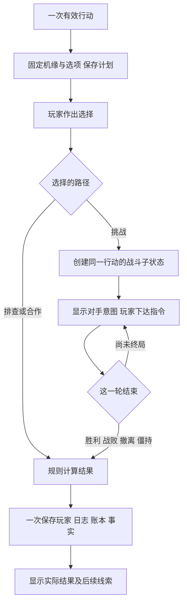

# 战斗参与与机缘分支规划

日期：2026 年 10 月 18 日。状态：提案，尚未实现。本轮只整理玩法、交互、模块边界和验收，不修改运行代码、概率、数值或存档。以下倍率、奖励和节奏为试作初值，须经数值复核和实际试玩校准。

## 1. 推荐方向

采用“重要战斗轻策略、普通战斗可托管、机缘选择有后续”的方向。玩家需要看懂当前局势、做出取舍，并看到选择造成的具体变化。保持虚构工科学园及纸本档案风格，不增加实时操作或阅读倒计时。

参与感来自三个环节：战前判断是否挑战；战中根据对手意图选择动作；战后看到这次选择留下的结果。机缘接在同一条行动链里，可以导向学习、合作或战斗，再由结果解锁后续。

## 2. 现有流程为何需要拆开

当前 `services/battleService.ts` 的 `resolveBattleEncounter` 会一次计算全部攻击、胜负、收益和掉落，`executeAdventureCore` 更新玩家后才打开 `BattleModal`。现有战斗按钮只有显示全部日志和关闭，不具备影响结果的指令入口。

当前手速决定初次先手和暴击比例，随后双方交替攻击；上限是 40 次单方攻击，双方仍存活也按未胜利处理。思维、体能及室友战力尚未接入现行战斗。机缘则主要将本地规则选出的结果拼入文本并直接结算，没有等待选项状态。

因此，应先把“一次算完”拆成“创建现场 → 每次指令推进 → 终局结算”，再加入交互。原战斗记录仍可用于结束后的复盘。这里是新的玩法提案，不承诺手动策略加入后每场收益仍与旧自动战斗相同；旧规则通道需保留回归基线。

## 3. 战斗：先做三个核心动作

每个决策轮先展示对手已经锁定的意图、双方精力与关键状态，再由玩家下达一个指令。程序不能在看到玩家选择后临时换招；随机结果与随机源状态需保存，读档不能重抽。

| 动作 | 试作规则 | 适合的局势与代价 |
| --- | --- | --- |
| 稳攻 | 使用现有基础攻击与暴击规则 | 稳定输出，适合普通来袭或能直接结束战斗时；没有防守收益 |
| 防守 | 不输出，本轮受到的攻击伤害暂拟减半 | 对方强攻且自己难以抢先结束时有价值；不能靠防守回血或领奖 |
| 破势 | 清除对方固守并正常输出；对无固守目标暂拟仅造成基础伤害的 75%；使用后需完成两个其他行动轮才能再用 | 用于突破减伤；不能每轮当作更强普攻 |

另设明确的“撤离”操作：立即结束这次挑战，保留已经发生的伤耗和已付入场成本，不领取胜利收益；首版建议不额外追加战败扣分。它不同于关闭面板，不能用来重新抽取同一次机缘。具体规则在试作前冻结并明示。

一个决策轮定义为：选择指令后，双方各至多执行一次行动，手速决定先后；一方先被击败时不再出手。防守与已公布的固守状态在本轮出手前生效，避免慢速角色明明选择防守却仍吃完整伤害。

敌人首版有三种可读意图：强攻、固守、调整。强攻伤害较高；固守形成至多持续两个决策轮的减伤；调整是输出较低的窗口。不同敌人采用不同状态策略，不固定循环“强攻—固守—调整”，也不根据玩家尚未提交的选择作弊。

### 三次连续决策的示例

以下是局部演示，不代表完整战斗或最终平衡数值：

| 当前信息 | 玩家选择 | 应看到的实际反馈 |
| --- | --- | --- |
| 自己精力偏低，对方准备强攻，无法直接击败对方 | 防守 | “本次来袭原损耗 18，防守后损耗 9”；精力条和记录一致 |
| 对方仍有固守，普通攻击会被减伤 | 破势 | 固守标记消失，展示本次有效伤害及破势冷却；没有隐藏额外奖励 |
| 对方进入调整、剩余精力接近一次普通攻击伤害 | 稳攻 | 若出手顺序和实际伤害足够，则在对方下一次强攻前结束；否则继续同一现场 |

如果自己能先手直接击败敌人，第一轮稳攻可能优于防守；对方没有固守时，破势也可能浪费窗口。验收应确认存在不同局势下的合理动作，不能形成一套始终最优的固定循环。

### 节奏与托管

首个新敌人、剧情挑战和重要对手默认提示玩家亲自应对；普通重复战斗可选择自动。托管使用同一套引擎和已公开信息，首版采用稳定策略，不拥有额外属性、隐蔽情报或奖励倍率。

允许玩家在自己的决策点选择“托管至结束”，并能在下一决策点接回。旧“跳过战斗”不能再表示提前获得结果；记录回放的跳过与实际战斗托管使用不同按钮含义。

初试目标为一场重要战斗约 4—8 次玩家决策；暂拟最多 12 个完整决策轮，超过后进入“僵持撤离”，保留伤耗、不发胜利奖，不把双方存活直接写成被击败。这是待校准的新规则，不是现有 40 次攻击上限的等价改名。

战斗期间暂停自动自习、自动期末、自动升学以及被动精力恢复；战斗状态使用固定属性快照，外部装备、用药和交易不能偷偷改变现场。没有真人倒计时，阅读或离线不会改变胜负。退出到手记可以收起面板，但行动继续保持待处理，不能靠关闭、等待或刷新免费恢复精力。

道具和室友支援留到第二批：先核对现有物品消费规则和室友 N09 等审计问题，再允许少量白名单道具或一次协作指令。首版不把目前无效的室友战力包装成已生效加成。

## 4. 机缘：一个选择对应一条结果路径

每个机缘提供 2—3 个主要选项，另可提供离开。选项至少在费用、风险、收益类型或后续内容上有区别。尽量避免只有一句文案不同，或者贵的选择在所有情况下都更差。

### 示例：研习室的旧装置突然报错

下表是本次机缘的完整结算草案；示例数值仅用于表达取舍，不与普通事件再叠加一份奖励。

| 选择 | 即时反馈示意 | 后续变化 |
| --- | --- | --- |
| 先查记录，稳妥排查 | 精力 −6、绩点 +10；获得“完成初步排查”事实标记，无战斗 | 后续同类机缘可出现“按上次笔记检查”的新选项，提供新的解法 |
| 直接联调，挑战问题核心 | 进入本次锁定的战斗现场；胜利示例为绩点 +24、学分 +8，实际伤耗由战斗决定；失败/撤离按已展示规则处理 | 只有胜利才解锁进阶挑战邀请；撤离记录“暂未完成”，不虚构已经修复 |
| 邀请室友，分工验证 | 有可用室友时：精力 −3、学分 −4、绩点 +6、该室友默契 +2；封顶不兑换奖励 | 绑定这名室友，解锁共同复测；后续对白引用这次分工 |

没有可用室友时，第三项明确改为“邀请同学协作”，仅获得对应学习结果和同学协作标记，不创建室友、不发不存在的默契。绑定角色不可用时不把结果转给另一名室友。

示例中的“绩点 +24、学分 +8”是该挑战路径的胜利总额，已经包含战斗与机缘部分，不在普通事件收益或战斗默认奖励之上再相加。子战斗只返回结算分项，由父行动统一发放。

“离开”不扣上述资源、不发奖励，也不生成修复或合作事实；结束本次机会，不能刷新获得另一套选项。资源不足的选项显示缺口，不在点击后突然扣成负数；允许暂存原计划，但进入机缘分支战斗后不能退出战斗去补资源。

机缘准备、等待选择和提交时，暂停自动自习、自动期末及自动升学，取消已经排定的自动操作；收起面板仍暂停，完成或明确离开后由玩家手动恢复。待选期可按原规则被动恢复，或由玩家手动补充资源，提交时按最新快照复验费用和前置条件，不重新抽计划；进入战斗后才冻结外部恢复和冲突操作。

风险选择如带概率，应在确认前说明成功率或风险范围；给出数值概率时必须来自本地规则。抽样固定、一次提交，不能每点一次重算。首批尽量使用确定的资源取舍，将主要不确定性放在可参与的战斗里。

## 5. 选择后的反馈分三层

1. **立即可见**：动作原因、精力变化、收益、状态增减，并说明为何触发。数字来自实际结算差额，不从 AI 文字中提取。
2. **稍后兑现**：新的选项、进阶挑战、共同复测等，在后续有效行动或里程碑触发；标记“后续待发生”，不提前宣传已经获得的收益。
3. **人物与档案记住**：同一室友在下一次场景引用已提交的决定，成长档案形成选择轨迹。先做有限事实记录，再做润色回顾。

关键机缘进入手记的“待决定”条目，完成后原地变成结果和后续线索。不能靠重复弹窗制造存在感；同一条线的后续应接在原事件下，避免满屏无关信息。

## 6. 战斗与机缘统一为一次行动

挑战分支沿用父行动 ID，战斗是子状态，不是再免费创建一次冒险。战斗基础奖励、原机缘额外奖励和选择成本合成同一结果明细；旧 handler 的叠加入口在新通道禁用，显示与到账使用同一账本。

战斗每次合法指令后保存现场及指令序号，读档继续同一轮、同一敌人和同一随机状态；终局再一次提交角色数值与奖励。重复指令、重复确认、迟到 AI 回复只能返回已有状态，不能推进第二次。外部角色恢复与成长暂停，避免战斗现场和全局玩家分叉；存储失败保留上一份已保存现场，不假报动作成功。

沿用之前关于同一 GameSave、剧情扩展和单写者的提案，仍需实施全部自动/手动/导入导出路径。同版本旧客户端可能丢扩展，不能承诺跨旧版本连续恢复。旧档缺少现场时按没有进行中行动加载，不能补发历史奖励。

这是对旧内容方案“首期战斗链不插入选择”的明确扩展：本需求新增机缘进入互动战斗的路径。新增规则进入提案，既有代码和存档尚未改变。人物记忆、数值审计和接口技能层的边界继续有效。

## 7. AI 的作用与纸本呈现

AI 可以描写当前局势、润色选项和战后复盘，不能决定敌人意图、伤害、成功率、选项 ID、掉落或人物记忆。每轮优先立即展示程序生成的意图和结果，不为出招逐轮等待模型。首版可仅在机缘开头和战后请求 AI，战中采用本地短句；关闭 AI 仍可体验全部玩法。

对应可扩展为 `choice-event`、`battle-intro`、`battle-review` 等游戏内 AI 能力，输入均为规则事实，结构校验后只写展示层，不授予模型执行战斗指令的权限。

界面沿用“挑战记录单”：上方为双方精力、手速与对手意图；中间只显示最近的动作及其原因；下方为三个主要动作和次要撤离/托管入口。手机固定底部操作区，重要费用和风险在确认前可见；完整记录在结束后展开，避免胜负未定时先显示最终奖励和总结。

## 8. 实施顺序与首版边界

| 阶段 | 交付 | 进入下一阶段的条件 |
| --- | --- | --- |
| A：规则基础 | 拆 create/step/resolve；统一现场、指令身份、保存和终局提交 | 固定种子下默认攻击复现旧规则；刷新、重复指令及保存失败不多扣多发 |
| B：一条纵向试作 | 一个三选项机缘，其中一个选项进入一场手动挑战；三个动作、撤离、三种意图 | 三条路线均能走完；失败和撤离有明确结果；选择确实改变最终现场 |
| C：首版内容 | 沿用原计划 6 个事件总量，拟调整为 4 个非战斗主导、2 个可导向战斗；扩充三类敌人行为及一个重要对手 | 不增加总事件数量先验证取舍与重复度；不同局势不存在始终占优的固定动作循环 |
| D：体验扩展 | 有限道具、室友协作、阶段回顾及更长后续 | 对应数值问题已处理，战斗和机缘账本稳定，再扩展更多组合 |

原三阶段室友项目继续保留为后续内容目标，不再与第一条互动战斗试作同时抢范围。首版不做连点反应、复杂技能树、多队伍战斗、新货币或每回合模型调用。

技术落点：`battleService` 提取战斗内核；`useAdventureHandlers` 改为创建待处理行动；`executeAdventureCore` 保留旧规则通道，终局经统一提交；`BattleModal` 区分进行中现场与已结束回放；`App` 暂停冲突的自动操作、恢复和升学；`features/save` 保存现场和账本；`utils/encounter` 与事件配置新增预置选项及后续标记。不要接回尚未启用的旧 features Hook。

## 9. 验收标准

- 同一个起点，对强攻选择防守与稳攻，实际伤耗或战局必须不同；结果不能在选择前已经写入玩家。
- 对同一固定敌人，至少存在适合稳攻、防守、破势的不同局势；换一个按钮不能总是得到相同结果。
- 三个机缘选项具有不同成本、结果或后续；至少一个差异能在下一次关联事件被实际验证。
- 胜利、战败、撤离、僵持均有独立终局；精力为零才走既有延毕流程，关闭面板不构成终局。
- 防守减伤应在基础伤害与暴击之后生效，避免被现有最低伤害项吞掉；说明、精力条、日志和最终到账一致。
- 战斗时等待不回血、不自动升学或换装；读档不重抽敌人、意图、奖励或机缘选项；点击与存储异常不重复结算。
- 机缘准备、待选和提交会暂停自动操作，收起不会恢复，结束后由玩家手动恢复；待选期的资源变化按最新快照复验，进入战斗后冻结外部恢复。
- 自动模式不代选机缘；托管和手动使用同一规则与奖励预算；在线和离线走同一路线时规则结果一致。
- 试玩重点记录是否看懂意图、能否说出选择理由、是否看到后续差异，以及单场决策数和中途退出原因。先进行小规模试玩，不把“按钮数量变多”视为参与感验收通过。

这份方案优先交付“一次机缘选择能改变一场战斗，并在之后留下不同反馈”的完整体验，再扩展技能、人物和事件数量。
